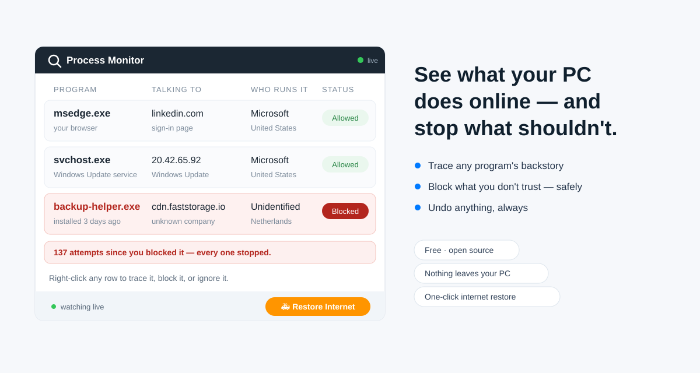
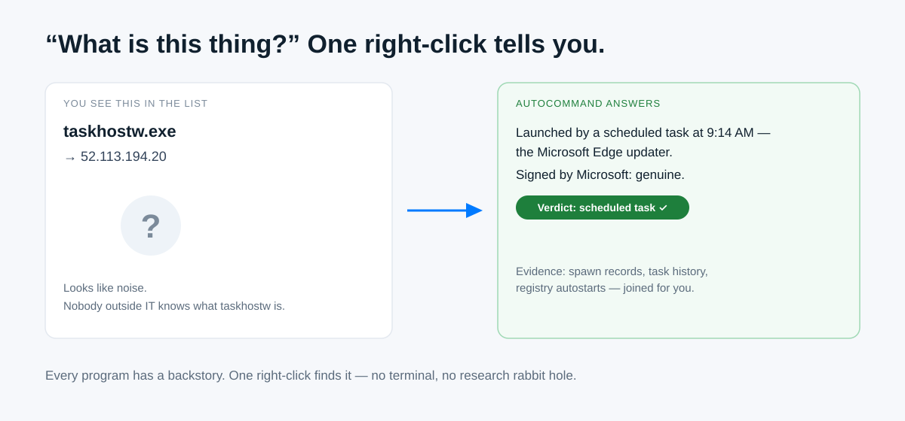
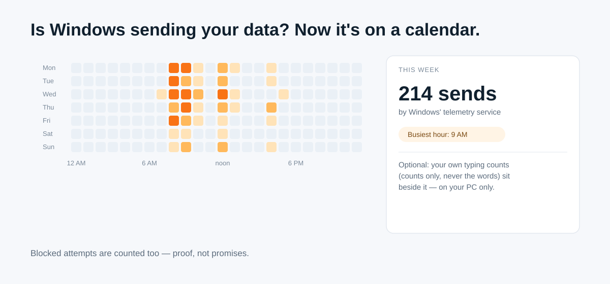
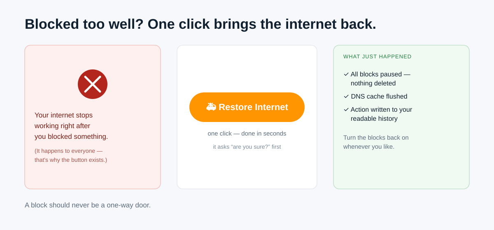
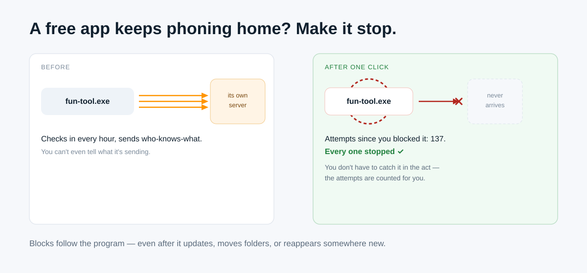
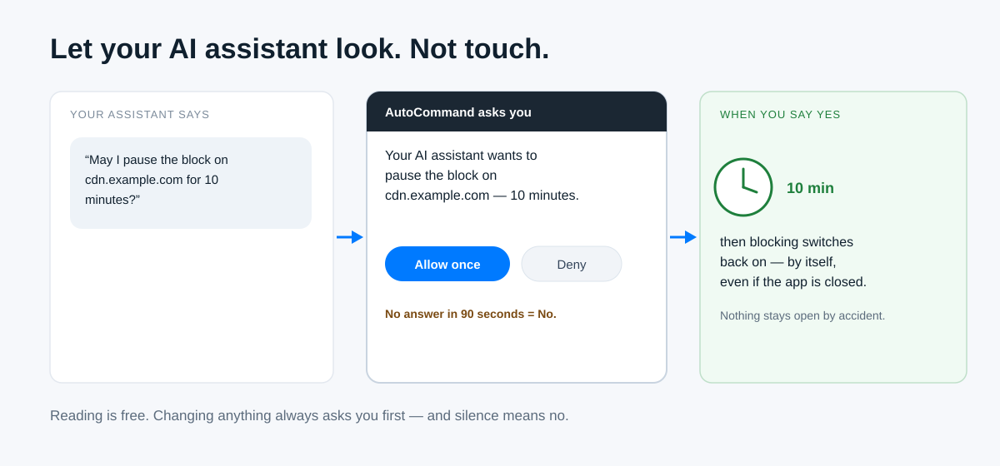

# AutoCommand

<b>See what your Windows PC does online — and stop what shouldn't.</b> 
Free · open source · everything stays on your PC

---

## Why people use it

### “What <i>is</i> this program on my PC?”

*Right-click → Trace. Every program's backstory — what launched it, when, and whether it's genuine — reconstructed from evidence on your own PC.*

### “Is my computer sending my data somewhere?”

*A week of Windows' data-sending on one calendar. Optional counts of your own typing sit beside it — counts only, never the words.*

### “I blocked something once and the internet died.”

*One button un-does every block AutoCommand ever made. Nothing deleted — switch them back on whenever.*

### “A free app I installed keeps phoning home.”

*Block it once. It stays blocked — even after it updates or moves — and you can watch it keep trying.*

### “I'd love AI help, without giving up control.”

*Assistants can read everything AutoCommand sees. Changing anything asks you first — silence means no, and temporary unblocks run out on their own.*

---

## Get started

1. **Download** the zip from [Releases](../../releases) and unzip it anywhere — no installer.
2. **Run `AutoCommand.exe`**, approve Windows' admin prompt. Security warning on first run? Right-click the included `unblock-autocommand.ps1` → *Run with PowerShell*, once.
3. **Click “Setup Sysmon”** when the main screen offers it — one click, downloaded from Microsoft, signature-checked before use.

## The safety net

- Every block is a **switch, not a demolition** — undo anywhere, and 🚑 **Restore Internet** lives in the bottom bar.
- **Risky blocks warn first. Dangerous ones are refused outright.**
- After a crash it **repairs its own leftovers** — and tells you what it fixed.
- **Sends nothing anywhere by default.** No account, no subscription, no phone-home — the one exception is an optional install count you must opt into, and even that carries only a random id the app invents itself, never your hardware, account, or IP ([PRIVACY.md](docs/PRIVACY.md)).

---

Windows 10 / 11 · 64-bit · Apache-2.0 · security issues: report privately via GitHub, please.
