<div align="center">
  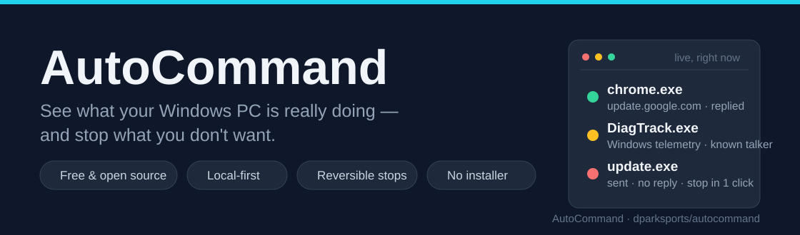

  **AutoCommand** — free, open-source Windows visibility, in plain English.

  [](../../releases/latest)
  [](LICENSE)
  [](../../releases/latest)
</div>

Antivirus matches files against a list of known-bad ones. That is a fine job — but it has nothing to say about the "clean" program phoning home more than it should, and it goes quiet exactly when your computer is acting weird. AutoCommand is the piece antivirus never gives you: **it shows you every program on your PC that talks to the internet, explains each one in plain English, and stops anything you don't want** — one click, undo included. It reports nothing about you to anyone (the only automatic outbound traffic asks public RDAP registries who owns an IP — the whole list is spelled out in [PRIVACY.md](docs/PRIVACY.md)), costs nothing, and its data lives in readable local files.

Keep your antivirus if you like it. They do different jobs. Many people run both.

## Try it in five minutes

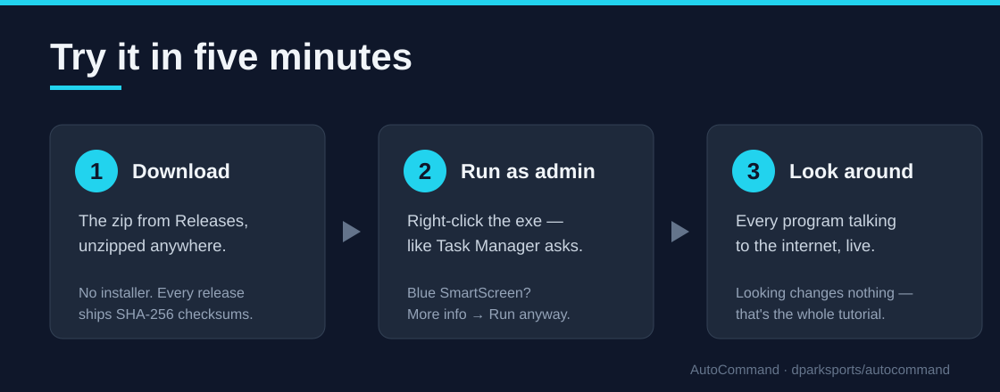

1. **Download** `AutoCommand-v…-win-x64.zip` from [Releases](../../releases/latest) and unzip it anywhere. There is no installer; every release ships with SHA-256 checksums so you can verify what you downloaded.
2. **Right-click `AutoCommand.exe` → Run as administrator.** The same reason Task Manager asks: to see the whole machine, not just your user. Windows may show a blue "protected your PC" screen because the app isn't from a big company — **More info → Run anyway**. It's open source; anyone can read exactly what it does, and that's rather the point.
3. **Look around, ask something.** The first screen lists every program talking to the internet right now. Looking changes nothing.

**No internet? (air-gapped PCs)** AutoCommand itself needs none: the zip is self-contained and everything it records stays on the machine. The one exception is **Sysmon** — Microsoft licenses it so it can't be bundled here, and the Spawns timeline and network attribution need it. On an offline PC: download `Sysmon64.exe` from [live.sysinternals.com](https://live.sysinternals.com/Sysmon64.exe) on any connected computer, move it over (USB), and either drop it next to `AutoCommand.exe` (or in its `tools` folder) before installing, or answer **Yes** when the offline message offers *"use a local copy"*. Microsoft's [Sysinternals license terms](https://learn.microsoft.com/en-us/sysinternals/license-terms) apply to your copy.

## How to read one row

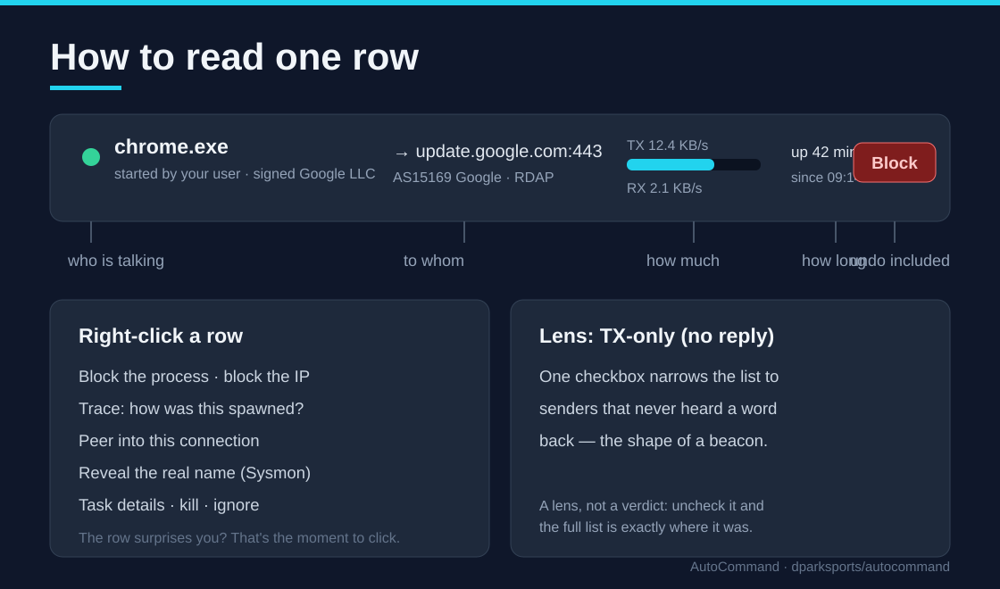

Every row tells you who's talking, to whom, how much, for how long — and gives you a Block button with an undo. Right-click for the deeper questions: *how was this spawned?*, *peer into this connection*, *reveal the real process name* (Sysmon), scheduled-task details, or *why is WSL offline?* When a row surprises you, *that's* the moment to click — not before. Most rows, you'll never need to think about.

One question the list answers for itself: the **TX-only (no reply)** checkbox — off by default — narrows the list to programs that *sent* packets and never heard one word back. That's the shape of a blocked outbound call or a dead-end beacon, and the checkbox shows how many are out there before you switch it on. It's a lens, not a verdict: uncheck it and the full list is exactly where it was.

## Where everything lives

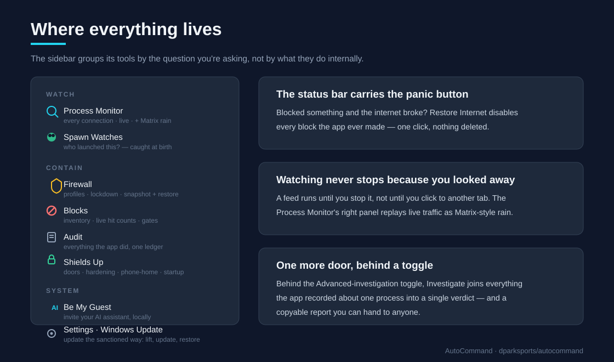

The sidebar groups its tools by the question you're asking, not by what they do internally. **Watch** holds the feeds: the Process Monitor (its right panel replays live traffic as Matrix-style rain; either pane folds from the thin rail between them) and Spawn Watches — "who launched this?", answered for scheduled-task launches, Python programs and the svchost timeline side by side. **Contain** holds the stopping tools: Firewall, Blocks, Audit (everything the app did, one ledger), Shields Up. **System** is the rest: Be My Guest, Settings, and Windows Update — the sanctioned way to update: lift exactly the update-pathway blocks, run the update, put everything back and verify. Behind the Advanced-investigation toggle sits **Investigate**, which joins everything the app recorded about one process into a single verdict and a copyable report. Watching never stops just because you looked away — a feed runs until you stop it, not until you click elsewhere.

## Watch: beyond the list

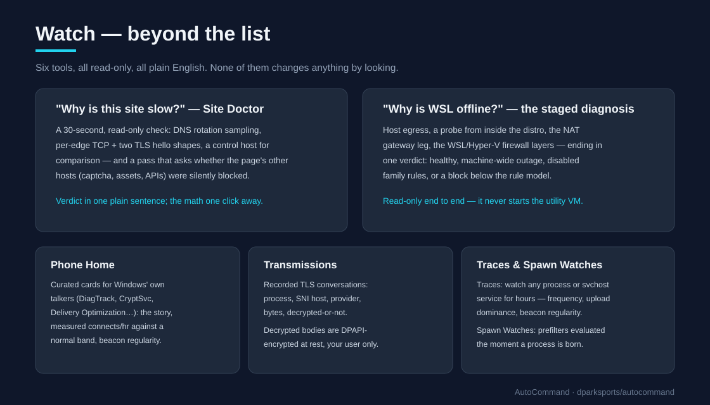

Six read-only tools answer the questions a connection list can't:

- **"Why is this site slow?"** — Site Doctor runs a ~30-second check (DNS rotation sampling, per-edge TCP and TLS hello shapes, a control host for comparison) and also asks the question nothing else asks: *were this page's other hosts — captcha, assets, APIs — silently blocked?* Verdict in one plain sentence, the math one click away.
- **"Why is WSL offline?"** — a staged, read-only pipeline from host egress down to the Hyper-V firewall layer, ending in one verdict. It never starts the utility VM.
- **Phone Home** — curated cards for Windows' own talkers (DiagTrack, CryptSvc, Delivery Optimization…): the plain-English story, measured connects-per-hour against a normal band, beacon regularity.
- **Transmissions** — the recorded-TLS archive: process, SNI host, provider, byte counts, decrypted-or-not. Decrypted bodies are DPAPI-encrypted at rest, readable only by your user.
- **Traces** — watch any process or svchost service for hours: frequency, destinations, upload dominance, beacon regularity.
- **Spawn Watches** — name-based prefilters evaluated the moment a process is *born*, so "what did svchost spawn?" is caught at birth, never chased after the fact.

## When something looks odd

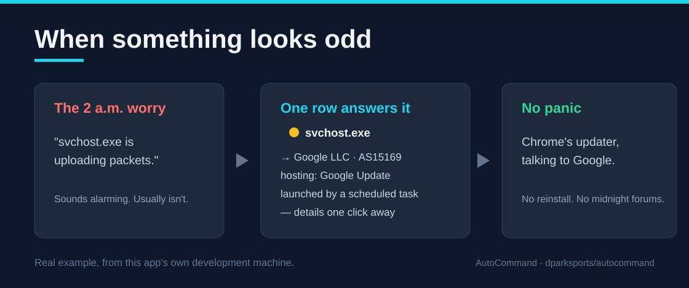

Real example, from this app's own development machine: *"svchost.exe is uploading packets"* sounds alarming — it turned out to be Chrome's updater downloading from Google's own servers, launched by a scheduled task, and AutoCommand proved it in one row. No panic, no reinstall, no forum archaeology at midnight.

## Contain: stopping is safe

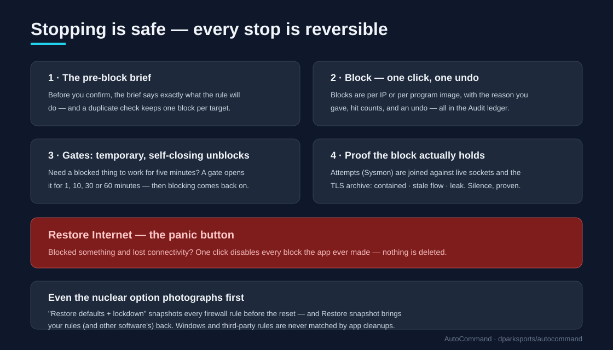

Security tools you're afraid to touch are security tools you won't use. A **pre-block brief** says exactly what the rule will do before you confirm (and a duplicate check keeps one block per target). Every block is reversible in one click and lands in the Audit ledger with the reason you gave. **Gates** open a blocked target for 1, 10, 30 or 60 minutes and re-arm themselves. And blocks don't just *look* stopped: attempts (Sysmon) are joined against live sockets and the TLS archive to prove **contained · stale flow · leak** — silent means silent. If it all goes wrong, the 🚑 **Restore Internet** button in the corner undoes every block the app ever made. Even the nuclear option — *restore defaults + lockdown* — photographs every firewall rule first, and **Restore snapshot** brings them back.

## Shields Up

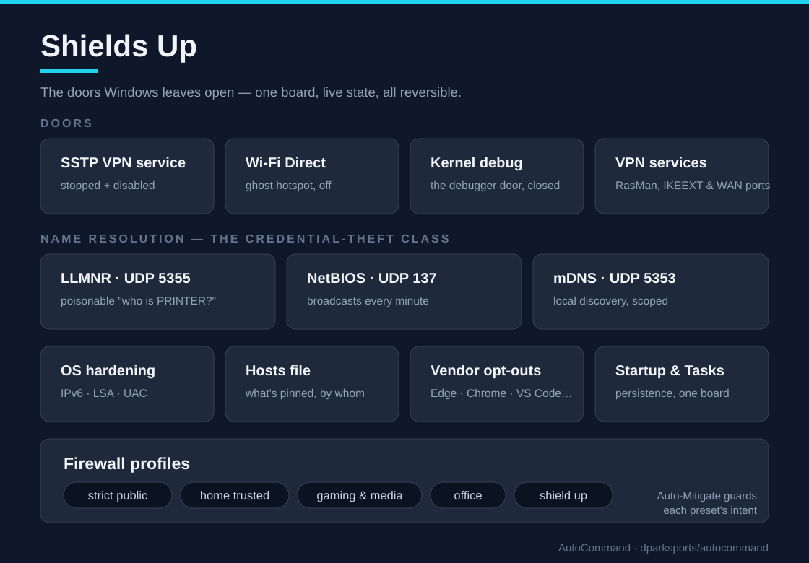

A second app folded in as one tab, on one board: the **doors** Windows leaves open (SSTP VPN service and miniports, the Wi-Fi Direct ghost hotspot, kernel debug, the VPN services and WAN miniports), the **legacy name-resolution** channels behind the LLMNR/NetBIOS poisoning credential-theft class, **OS hardening** switches (IPv6, LSA Protection, UAC strictness), the **hosts-file audit**, one-click **vendor telemetry opt-outs** (Edge, Chrome, VS Code, PowerShell 7, .NET CLI, Windows diagnostic data…), **Startup & Tasks** — the persistence surface on one board — and **firewall profiles** (strict public · home trusted · gaming & media · office · shield up) that Auto-Mitigate guards against drift. Everything reads live state, never a preference file; closing a door is one click, and re-opening it is a decision only you make, in the tab.

## Be My Guest — your AI assistant, invited

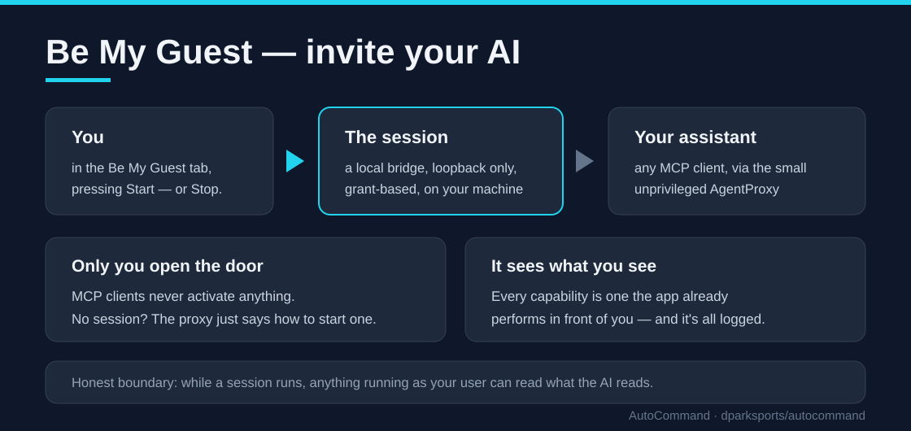

If you use an AI assistant, the **Be My Guest** tab can invite it to read the same facts the app sees — who launched what, where things connect, what got blocked — through a local bridge on your own machine. **The door is only open while you keep it open**: sessions start only from the tab's Start button, MCP clients never activate anything (they connect through the small unprivileged AgentProxy, which answers with setup guidance when no session is running), every capability is one the app already performs in front of you, and every tool call lands in the live activity log. No cloud middleman, no account, nothing to create. One honest boundary, stated up front: while a session runs, its token lives in a local file — anything running as your user can read what the AI reads.

## What it sends about you

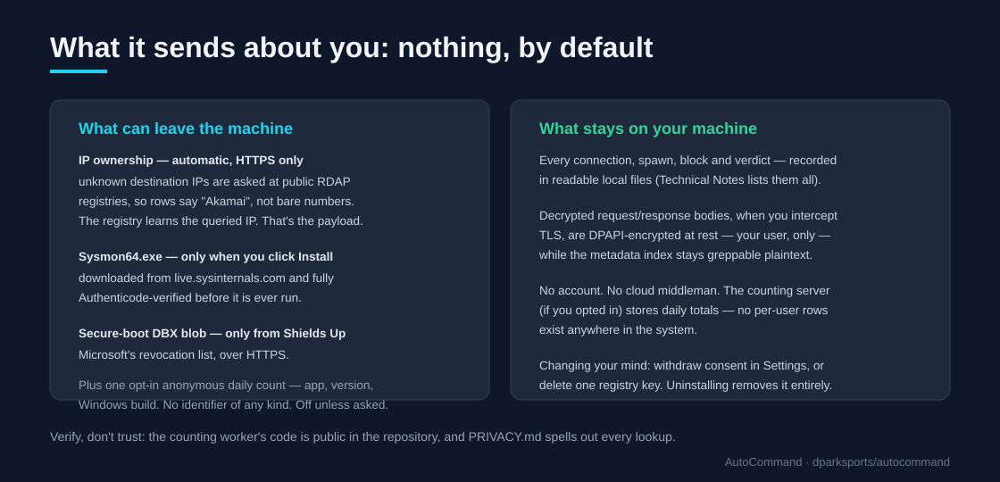

**Nothing, by default.** Everything happens on your computer. Three features reach the internet, each sending only what that feature needs: automatic RDAP lookups (who owns this IP — HTTPS, the registry learns the queried IP and nothing else), the Sysmon download (only when you click Install, Authenticode-verified before it runs), and the secure-boot DBX blob (only from Shields Up). The one optional extra — an anonymous daily count with no identifiers, not even a random one — exists so the project can show a download graph, and it is off unless you say yes. Details, and how to withdraw consent, in [PRIVACY.md](docs/PRIVACY.md).

## Built so you can experiment safely

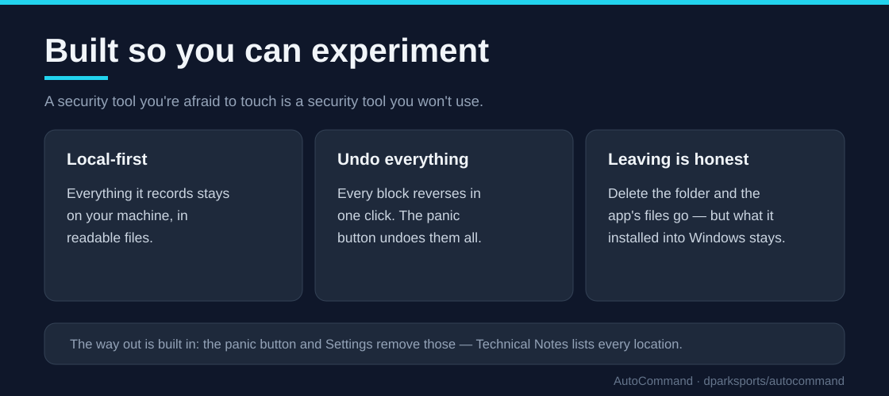

Everything it records stays in readable local files on your machine. Every stop is reversible — per block, per gate, or all at once with the panic button. There's no installer, no account, and leaving is honest: delete the folder and the app's own files go with it, but things it installed *into Windows* on your behalf — the Sysmon driver (if you installed it), firewall rules, hosts pins — outlive the folder. The panic button and Settings remove those; engine-level removal primitives (delete every app-made firewall rule, uninstall Sysmon, strip telemetry pins) landed in v2026.11.10.6 with a one-click removal wizard on the way; and [TECHNICAL_NOTES](docs/TECHNICAL_NOTES.md) lists every location, so nothing is a mystery.

## Where it came from

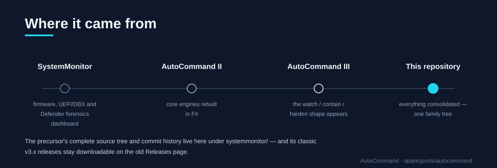

This started as **SystemMonitor** — a firmware, UEFI/DBX and Defender forensics dashboard. The core engines were later rebuilt in F#, shipped as AutoCommand II and then III, and everything has since been consolidated into this one repository. The precursor's **complete source tree and commit history** live here under [`systemmonitor/`](systemmonitor/README.md); its classic v3.x releases remain downloadable on the [old Releases page](https://github.com/dparksports/SystemMonitor/releases). One repo now holds the whole family tree.

## For developers and tinkerers

The C# WPF shell drives app-agnostic **F# engines** (firewall with strong-typed COM, Sysmon watching, DNS/geo/RDAP, TLS interception, forensics, site diagnosis, the MCP agent bridge). The full story of that rebuild — what moved, what was ported forward — is in [docs/history/README-III.md](docs/history/README-III.md).

```powershell
# .NET 10 SDK required
git clone https://github.com/dparksports/autocommand.git
cd autocommand
dotnet build AutoCommand.csproj -c Release

# self-contained build (what the releases ship)
dotnet publish AutoCommand.csproj -c Release -r win-x64 --self-contained

# offline self-test suites (synthetic inputs, run anywhere) — eleven of them, e.g.
dotnet run --project ContainSelfTest
dotnet run --project NetWatchSelfTest
dotnet run --project WslSelfTest
```

The `systemmonitor/` tree is the preserved precursor — it is excluded from the app build on purpose; don't expect it to compile into anything. Release automation lives in [`.github/workflows/`](.github/workflows/): every push runs the self-test gate (plus a dependency-vulnerability check), and a `v20…` tag builds and attaches the release zip with checksums — keeping one release per day. Bugs and ideas: see [SUPPORT.md](docs/SUPPORT.md); security reports: [SECURITY.md](docs/SECURITY.md) — please use private reporting.

## Common questions

| What you see | What to do |
|---|---|
| "A program I don't recognize is on the list" | Most are normal Windows parts. Double-click the row — it shows who started it and where it connects. Still unsure? Invite your AI assistant to take a look (Be My Guest). |
| "It asked for Administrator permission" | That's how it sees system processes, not just yours. It never uses that permission without asking you first. |
| "Should I remove my antivirus?" | Your call — they do different jobs. AutoCommand shows what's happening; antivirus scans files. Many people run both. |
| "What does it send about me?" | Nothing, by default. The three narrow lookups and the optional anonymous count are spelled out above and in [PRIVACY.md](docs/PRIVACY.md). |
| "I blocked something and the internet broke" | Breathe. The 🚑 **Restore Internet** button undoes every block the app made, in one click. |
| "A gate is open and I'm done early" | Close it from Blocks — one click, blocking returns immediately. |

## License

[Apache-2.0](LICENSE). Free to use, free to read, free to leave.
