<div align="center">
  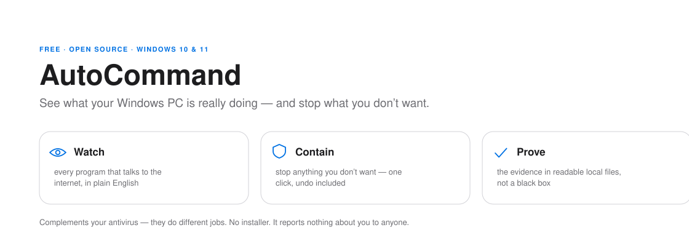

  **See what your Windows PC is really doing. Stop what you don't want.**

  [](../../releases/latest)
  [](LICENSE)
  [](../../releases/latest)
</div>

---

Antivirus answers one question: *is this file on a known-bad list?* It has nothing to say about the "clean" program that phones home more than it should — and it goes quiet exactly when your computer starts acting weird.

**AutoCommand answers the other question.** It shows every program on your PC that talks to the internet, explains each one in plain English, and stops anything you don't want — one click, undo included. It costs nothing, reports nothing about you (the only automatic outbound traffic asks public RDAP registries who owns an IP — spelled out in [PRIVACY.md](docs/PRIVACY.md)), and keeps its data in readable local files.

Keep your antivirus. This is the other half. Many people run both.

## Try it in five minutes

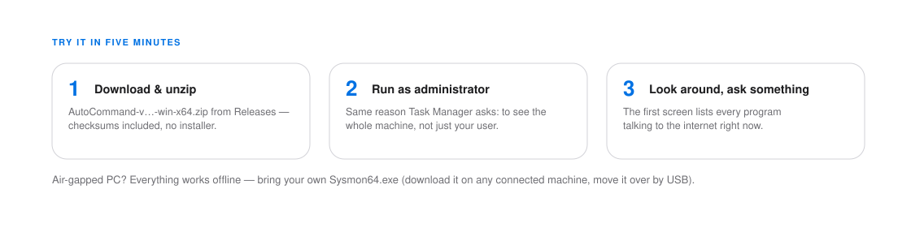

1. **Download** `AutoCommand-v…-win-x64.zip` from [Releases](../../releases/latest) and unzip it anywhere. No installer; every release ships SHA-256 checksums so you can verify what you downloaded.
2. **Right-click `AutoCommand.exe` → Run as administrator** — the same reason Task Manager asks: to see the whole machine, not just your user. Windows may show a blue "protected your PC" screen because the app isn't from a big company: **More info → Run anyway**. It's open source — anyone can read exactly what it does, and that's rather the point.
3. **Look around.** The first screen lists every program talking to the internet right now. Looking changes nothing.

**Air-gapped PCs:** AutoCommand itself needs no internet — the zip is self-contained and everything it records stays on the machine. The one exception is **Sysmon**, which Microsoft licenses so it can't be bundled (the Spawns timeline and network attribution need it). On an offline PC: download [`Sysmon64.exe`](https://live.sysinternals.com/Sysmon64.exe) on any connected machine, move it over by USB, drop it next to `AutoCommand.exe` (or in its `tools` folder), or answer **Yes** when the offline message offers *"use a local copy"*. [Sysinternals license terms](https://learn.microsoft.com/en-us/sysinternals/license-terms) apply to your copy.

## One row tells the whole story

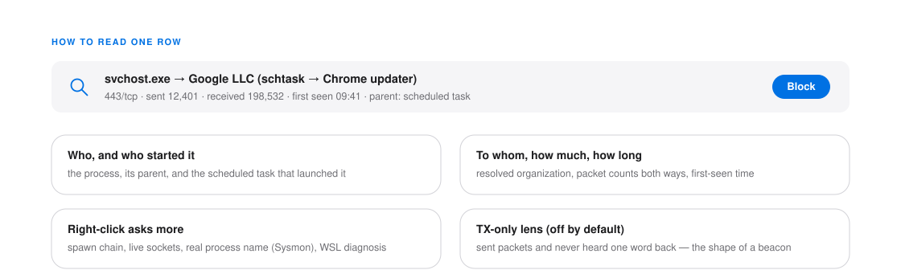

Every row answers *who's talking, to whom, how much, for how long* — with a Block button and an undo. Right-click for the deeper questions: *how was this spawned?*, *peer into this connection*, *reveal the real process name* (Sysmon), scheduled-task details, *why is WSL offline?* When a row surprises you, that's the moment to click — not before.

One lens the list gives itself: **TX-only (no reply)** — off by default — narrows to programs that *sent* packets and never heard one word back: the shape of a blocked call or a dead-end beacon. It's a lens, not a verdict; uncheck it and the full list is exactly where it was.

## The map: three questions, three groups

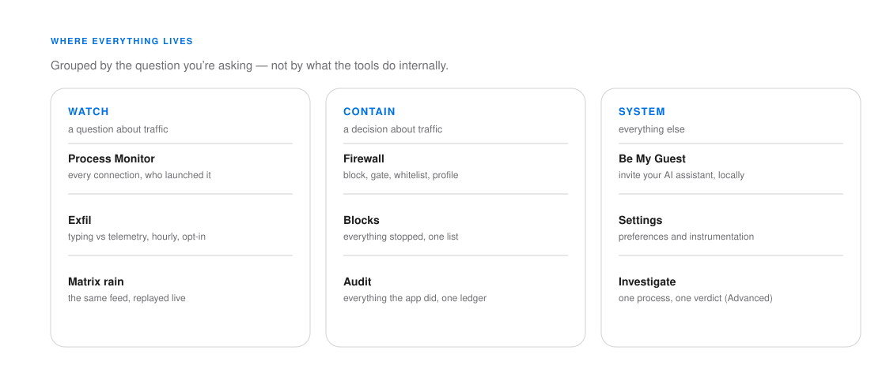

The sidebar is grouped by the question you're asking, not by what the tools do internally:

- **WATCH — a question about traffic.** Process Monitor (every connection, who launched it; its right panel replays the feed as Matrix-style rain, and either pane folds from the thin rail), **Exfil** — typing vs telemetry: DiagTrack's hourly transmit cadence over the last 7 days beside your keystroke counts *if — and only if — you opt in* (counts only, never which keys, stored locally, kept 8 days). The point: traffic that follows your typing is you; traffic that fires while you're away is the machine.
- **CONTAIN — a decision about traffic.** Firewall, Blocks, and Audit — everything the app ever did, one ledger.
- **SYSTEM — everything else.** Be My Guest (invite your AI assistant, locally), Ask AutoCommand (chat with the app directly — opt-in), and Settings. Behind the Advanced-investigation toggle sits **Investigate**, which joins everything recorded about one process into a single verdict and a copyable report.

A feed runs until you stop it — watching never pauses just because you looked away.

## Beyond the list

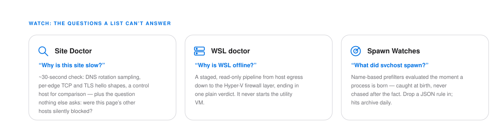

Three read-only tools answer what a connection list can't:

- **"Why is this site slow?"** — Site Doctor: a ~30-second check (DNS rotation sampling, per-edge TCP and TLS hello shapes, a control host for comparison) that also asks the question nothing else asks — *were this page's other hosts (captcha, assets, APIs) silently blocked?* Verdict in one plain sentence, the math one click away.
- **"Why is WSL offline?"** — a staged, read-only pipeline from host egress down to the Hyper-V firewall layer, ending in one verdict. It never starts the utility VM.
- **"What did svchost spawn?"** — Spawn Watches: name-based prefilters evaluated the moment a process is *born*, so the answer is caught at birth, never chased. Rules are JSON files in `%LOCALAPPDATA%\AutoCommand\watches` (drop one in, no restart), surfaced to your AI assistant as `list_watches` / `tail_watches`; per-day hit files compress to `.gz` on rollover and archives prune after 30 days.

## The 2 a.m. worry, answered by one row

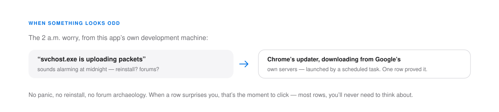

Real example from this app's own development machine: *"svchost.exe is uploading packets"* sounds alarming — it turned out to be Chrome's updater downloading from Google's own servers, launched by a scheduled task. AutoCommand proved it in one row. No panic, no reinstall, no forum archaeology at midnight.

## Stopping is safe

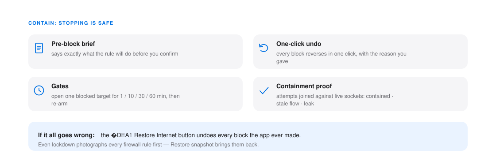

A security tool you're afraid to touch is a security tool you won't use:

- A **pre-block brief** says exactly what the rule will do before you confirm (and a duplicate check keeps one block per target). The same dialog now probes shared infrastructure: if the addresses you're about to block also serve Windows Update or the connectivity check, it says so before you click — and again in the rule's provenance afterwards.
- Every block **reverses in one click** and lands in the Audit ledger with the reason you gave.
- **Gates** open a blocked target for 1, 10, 30 or 60 minutes and re-arm themselves.
- Blocks don't just *look* stopped: attempts (Sysmon) are joined against live sockets and the TLS archive to prove **contained · stale flow · leak** — silent means silent. When something *does* hit a rule, the **deny watcher** (Windows' kernel-level "connection blocked" telemetry, enabled automatically) toasts you within a second: what tried, where, and that it will keep failing until you decide — no more mysterious "your internet access is blocked" browser pages with no explanation.
- **Block domains, not just IPs** (🌐 Domain blocks on the Blocks tab): CDNs rotate their addresses by the minute, so a pinned-IP blocklist misses tomorrow. Name a hostname instead and AutoCommand re-resolves it on a cadence — new addresses get blocked, rotated addresses get retired, and a rule you blocked by hand is never touched (ownership is proven by the rule's own provenance marker, not a guess).
- **Friendly block pages** (opt-in in Settings): while enabled, a request your own firewall rules refuse gets a plain-English page — what was blocked, why, and how to undo it — instead of the browser's raw error. **Browsers only by default**: every connection through the proxy is attributed to its client process via the kernel connection table, and only browsers (Edge, Chrome, Brave, Firefox, Opera, Vivaldi — extendable via `%LOCALAPPDATA%\AutoCommand\browsers.txt`) are checked against your blocks; other apps' requests forward untouched and stay covered by the firewall layer, and embedded WebView2 (`msedgewebview2.exe`, hosted by many desktop apps) is excluded unless you opt in. Only blocked hostnames are ever inspected; everything else forwards untouched. The proxy settings and the local CA it uses exist *only* while the toggle is on, are journaled so a crash can't strand them, and restore themselves on toggle-off, app exit, or crash.
- If it all goes wrong, the 🚑 **Restore Internet** button undoes every block the app ever made. Even the nuclear option — *restore defaults + lockdown* — photographs every firewall rule first, and **Restore snapshot** brings them back.

## Shields Up

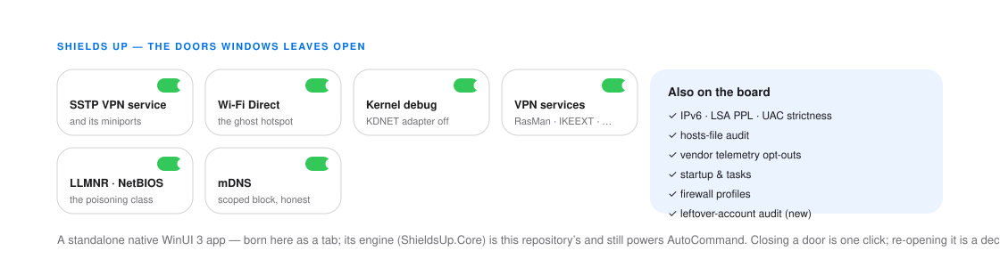

The **doors** Windows leaves open — the SSTP VPN service and miniports, the Wi-Fi Direct ghost hotspot, kernel debug, the VPN services and WAN miniports — plus the **legacy name-resolution** channels behind the LLMNR/NetBIOS poisoning credential-theft class, **OS hardening** switches (IPv6, LSA Protection, UAC strictness), the **hosts-file audit**, one-click **vendor telemetry opt-outs** (Edge, Chrome, VS Code, PowerShell 7, .NET CLI, Windows diagnostic data…), **Startup & Tasks** (the persistence surface on one board), **firewall profiles** (strict public · home trusted · gaming & media · office · shield up), and the **leftover-account audit** — the disabled `defaultuser0`-class bootstrap accounts and orphaned profiles Windows Setup leaves behind, with a guarded one-click prune.

Born here as a tab, Shields Up is now also the standalone native WinUI 3 [Shields Up app](https://github.com/dparksports/shields-up) — its engine, `ShieldsUp.Core`, is this repository's and still powers AutoCommand. AutoCommand keeps the enforcing half in-process: your AI assistant can read the doors' status, close a door, flip a vendor's own opt-out switch or apply a firewall profile through the agent bridge, and **Auto-Mitigate** guards each preset's intent against drift. Everything reads live state, never a preference file. Closing a door is one click; re-opening it is a decision only you make.

## Be My Guest — your AI assistant, invited

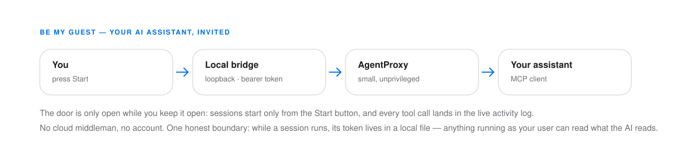

If you use an AI assistant, the **Be My Guest** tab can invite it to read the same facts the app sees — who launched what, where things connect, what got blocked — through a local bridge on your own machine. **The door is only open while you keep it open**: sessions start only from the tab's Start button; MCP clients never activate anything (they connect through the small unprivileged AgentProxy, which answers with setup guidance when no session is running); every capability is one the app already performs in front of you; every tool call lands in the live activity log. No cloud middleman, no account, nothing to create.

One honest boundary, stated up front: while a session runs, its token lives in a local file — anything running as your user can read what the AI reads.

## Ask AutoCommand — talk to the app directly

The **Ask AutoCommand** tab is the direct line: you ask in plain English and the app answers — powered by GLM (a cloud model from Z.ai), **off by default** and enabled only through an explicit consent dialog plus your own API key. Once on, the model reads the same live facts the AI bridge serves — through the same tools, with the same confirmation window in front of every single change. What you type, and the tool answers the model reads, travel to the model endpoint; the transcript never touches disk, your key is DPAPI-encrypted on your machine, and every request lands in the same activity log.

## What it sends about you

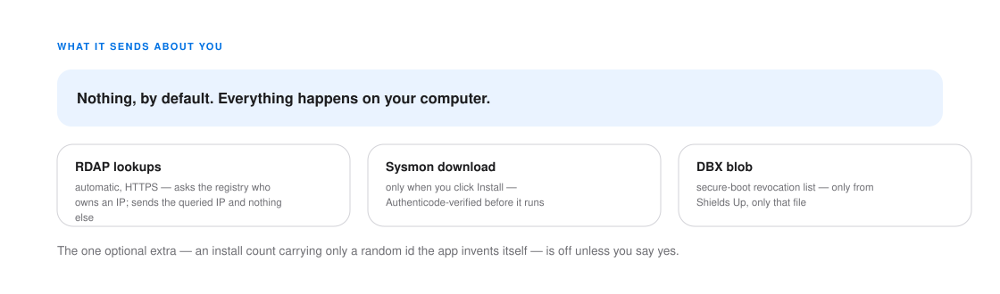

**Nothing, by default.** Everything happens on your computer. Four features reach the internet, each sending only what that feature needs:

| Feature | Sends | Where |
|---|---|---|
| RDAP lookups (automatic) | the queried IP, nothing else | public IP-ownership registries, HTTPS |
| Sysmon download (on Install click) | the download request | Microsoft, Authenticode-verified before it runs |
| Secure-boot DBX blob (Shields Up) | the fetch for that one file | Microsoft |
| Ask AutoCommand (opt-in chat) | your conversation text + the tool answers the model reads | the GLM endpoint you pick in the tab (Z.ai / Zhipu), HTTPS |

The one optional extra — an anonymous daily count with no identifiers, not even a random one, so the project can show a usage graph — is **off unless you say yes**. Details and how to withdraw consent: [PRIVACY.md](docs/PRIVACY.md).

## Built to leave

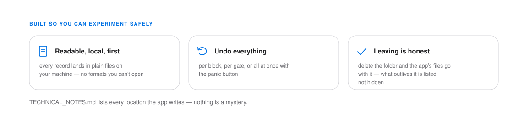

No installer, no account, no lock-in. Everything it records stays in readable local files on your machine, and every stop is reversible — per block, per gate, or all at once. Leaving is honest: delete the folder and the app's own files go with it, but things it installed *into Windows* on your behalf — the Sysmon driver (if you installed it), firewall rules, hosts pins — outlive the folder. The panic button and Settings remove those; engine-level removal primitives (delete every app-made firewall rule, uninstall Sysmon, strip telemetry pins) landed in v2026.11.10.6; and [TECHNICAL_NOTES](docs/TECHNICAL_NOTES.md) lists every location, so nothing is a mystery.

## Where it came from

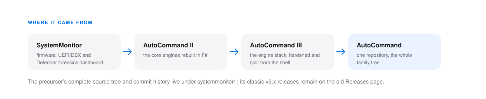

This started as **SystemMonitor** — a firmware, UEFI/DBX and Defender forensics dashboard. The core engines were rebuilt in F# and shipped as AutoCommand II and III; today everything lives in this one repository. The precursor's history and its classic v3.x releases remain on the [old Releases page](https://github.com/dparksports/SystemMonitor/releases). One repo, the whole family tree.

## For developers and tinkerers

A C# WPF shell drives app-agnostic **F# engines** — firewall with strong-typed COM, Sysmon watching, DNS/geo/RDAP, TLS interception, forensics, site diagnosis, the MCP agent bridge. The full story of that rebuild is in [docs/history/README-III.md](docs/history/README-III.md).

```powershell
# .NET 10 SDK required
git clone https://github.com/dparksports/autocommand.git
cd autocommand
dotnet build AutoCommand.csproj -c Release

# self-contained build (what the releases ship)
dotnet publish AutoCommand.csproj -c Release -r win-x64 --self-contained

# offline self-test suites (synthetic inputs, run anywhere) — fifteen of them, e.g.
dotnet run --project tests/ContainSelfTest
dotnet run --project tests/HardenSelfTest
dotnet run --project tests/WslSelfTest
```

The `systemmonitor/` tree is the preserved precursor, excluded from the app build on purpose — don't expect it to compile into anything. Release automation lives in [`.github/workflows/`](.github/workflows/): every push runs the self-test gate (plus a dependency-vulnerability check), and a `v20…` tag builds and attaches the release zip with checksums — one release per day. The README infographics are generated: `deno run --allow-read --allow-write assets/generate_infographics.mjs` (was Python; the Apple-HIG redesign ships as Deno). Bugs and ideas: [SUPPORT.md](docs/SUPPORT.md); security reports: [SECURITY.md](docs/SECURITY.md) — please use private reporting.

## Common questions

| What you see | What to do |
|---|---|
| "A program I don't recognize is on the list" | Most are normal Windows parts. Double-click the row — it shows who started it and where it connects. Still unsure? Invite your AI assistant to take a look (Be My Guest). |
| "It asked for Administrator permission" | That's how it sees system processes, not just yours. It never uses that permission without asking you first. |
| "Should I remove my antivirus?" | Your call — they do different jobs. AutoCommand shows what's happening; antivirus scans files. Many people run both. |
| "What does it send about me?" | Nothing, by default. The three narrow lookups and the optional anonymous count are spelled out above and in [PRIVACY.md](docs/PRIVACY.md). |
| "I blocked something and the internet broke" | Breathe. The 🚑 **Restore Internet** button undoes every block the app made, in one click. |
